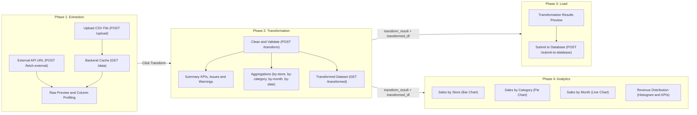
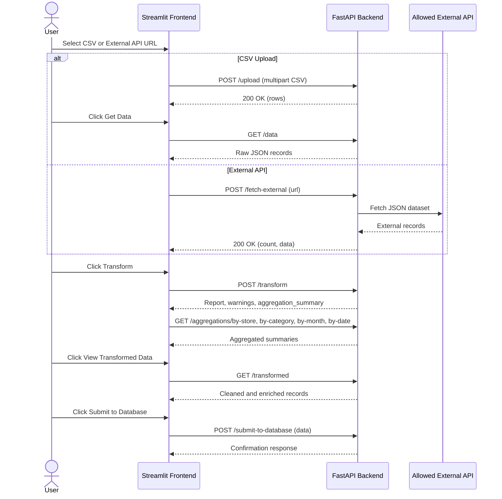
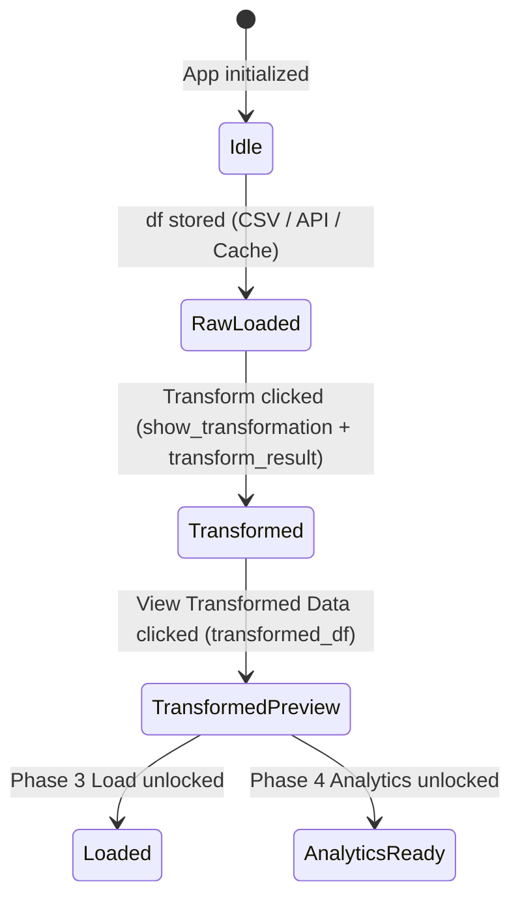
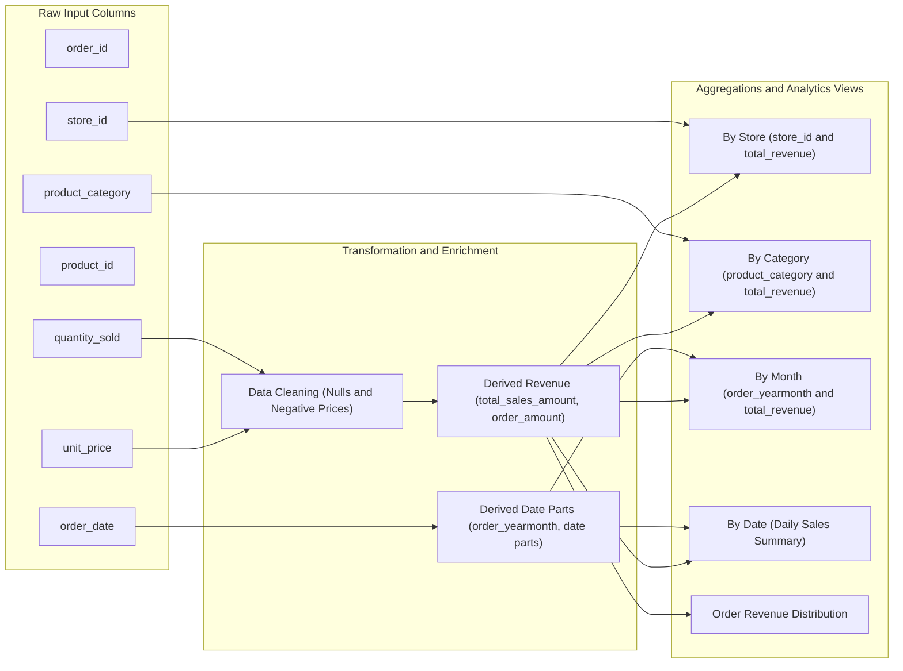
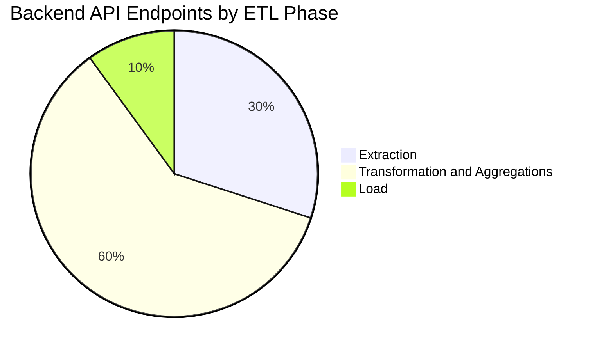

# Retail Sales Data ETL & Analytics Platform


A comprehensive Streamlit-based application for Extracting, Transforming, and Loading retail sales data with advanced analytics capabilities. This platform provides a complete ETL pipeline with interactive visualizations and data insights.

## Features

The platform is organized into four progressive ETL & Analytics phases managed via `st.session_state` in [app.py](app.py):

| Phase | Stage | Core Capabilities | Primary UI Controls | Backend Endpoints |
| :--- | :--- | :--- | :--- | :--- |
| **Phase 1** | **Extraction** | CSV upload, external API ingestion, interactive preview, row/column KPIs, and null/dtype profiling | `Select Data Source`, `Upload File`, `Fetch from External API`, `Get Data` | `POST /upload`, `POST /fetch-external`, `GET /data` |
| **Phase 2** | **Transformation** | Null/negative-price cleaning, derived metrics, validation warnings, and multi-dimensional aggregations | `Transform`, `View Transformed Data` | `POST /transform`, `GET /transformed`, `GET /aggregations/*` |
| **Phase 3** | **Load** | Review of cleaned transformation output and database submission trigger | `Submit to Database` | `POST /submit-to-database` |
| **Phase 4** | **Analytics** | Interactive store, category, monthly trend, and revenue distribution charts with summary KPIs | `Select Chart Type` | `GET /aggregations/by-store`, `/by-category`, `/by-month` |

<details>
<summary><strong>Explore Detailed Phase-by-Phase Feature Breakdown</strong></summary>

#### Phase 1: Extraction
- **Dual Ingestion Modes**: Upload local `.csv` files or pull JSON records from allowlisted external REST endpoints (`jsonplaceholder.typicode.com`, `hcl-hacthon-store-one-details-1.onrender.com`).
- **Raw Data Preview**: Displays `Total Rows`, `Total Columns`, and active `Data Source` metrics alongside an interactive `st.dataframe` table (`height=400`).
- **Column Profiling**: Automatically computes `Column Name`, `Data Type`, `Non-Null Count`, and `Null Count` for every ingested column.

#### Phase 2: Transformation
- **Automated Data Cleaning**: Handles null values, negative prices, and data inconsistencies.
- **Feature Engineering**: Generates derived analytical columns (`total_sales_amount`, `order_amount`, `order_yearmonth`, and date parts).
- **Quality & Validation Reporting**: Displays `Original Rows`, `Total Columns`, `Rows After Transform`, and `Issues Fixed` KPIs, plus itemized `issues_fixed` and `validation_warnings` alerts.
- **Aggregation Tables**: Retrieves and renders sales summaries grouped by store, product category, month, and date.

#### Phase 3: Load
- **Transformation Results Preview**: Presents the verified `transformed_df` dataset ready for persistence.
- **Database Submission**: Sends transformed records as JSON (`{"data": ...}`) to `POST /submit-to-database`.

> [!NOTE]
> The `Submit to Database` action in `app.py` currently invokes a simulated/placeholder backend submission endpoint (`POST /submit-to-database`).

#### Phase 4: Analytics
- **Multi-Chart Selector**: Switch dynamically between Store Bar Chart, Category Pie Chart, Monthly Trend Line Chart, and Revenue Distribution Histogram.
- **Paired Data & Statistics**: Each chart pairs with its underlying aggregation table or summary revenue metrics (`Mean Revenue`, `Median Revenue`, `Max Revenue`).

</details>

---

## Architecture & Pipeline Flow

### End-to-End ETL Workflow



### System Component Classification

| Layer | Component | Technology | Responsibility | Reference |
| :--- | :--- | :--- | :--- | :--- |
| **Presentation** | Web Interface | Streamlit (`layout="wide"`) | Interactive 4-phase UI, metric cards, tables, and custom CSS styling | [app.py](app.py) |
| **Data Handling** | Tabular Engine | Pandas | DataFrame construction, column dtype/null inspection, and revenue stats | [app.py](app.py#L187-L194) |
| **Visualization** | Charting Layer | Streamlit Charts & Matplotlib | Bar/line charts (`st.bar_chart`, `st.line_chart`) and pie/histogram figures | [app.py](app.py#L369-L430) |
| **Transport** | HTTP Client | Requests | Multipart file uploads, JSON payloads, and REST endpoint consumption | [app.py](app.py#L80-L157) |
| **Backend Service** | ETL & Transform API | FastAPI (hosted on Render) | Ingestion cache, cleaning, validation, aggregations, and persistence | `https://hcl-final-hackathon-backend.onrender.com` |
| **Environment** | Dev Container | Python 3.11 Bookworm | Preconfigured VS Code / Codespaces setup exposing port `8501` | [.devcontainer/devcontainer.json](.devcontainer/devcontainer.json) |

<details>
<summary><strong>Interactive Sequence & Session State Diagrams</strong></summary>

#### Frontend–Backend Interaction Sequence



#### Progressive UI State Lifecycle (`st.session_state`)



</details>

---

## Data Schema & Transformations

### Supported Input Formats

| Format | Ingestion Path | Source / Domain Support | Capabilities |
| :--- | :--- | :--- | :--- |
| **CSV** | `Upload CSV File` (`POST /upload`) | Local `.csv` files via `st.file_uploader` | Standard retail sales tabular input with automatic schema inspection |
| **JSON** | `Fetch from External API` (`POST /fetch-external`) | `jsonplaceholder.typicode.com`, `hcl-hacthon-store-one-details-1.onrender.com` | Live REST payload ingestion directly into DataFrame preview |

### Expected Retail Sales Schema

| Column Name | Expected Format / Type | Role | Description |
| :--- | :--- | :--- | :--- |
| `order_id` | String / Integer | Identifier | Unique order transaction identifier |
| `order_date` | Date (`YYYY-MM-DD`) | Temporal Key | Date of the retail order; parsed into date parts & `order_yearmonth` |
| `store_id` | String / Integer | Dimension | Store identifier used for store-level revenue aggregation |
| `product_id` | String / Integer | Dimension | Product SKU / item identifier |
| `product_category` | String | Dimension | Category classification used for category share breakdowns |
| `quantity_sold` | Numeric (Integer) | Measure | Number of units sold in the order |
| `unit_price` | Numeric (Float) | Measure | Price per unit (validated against negative/invalid entries) |

### Data Lineage & Derived Features



---

## Analytics & Visualizations

Phase 4 (`Sales Insights Visualization`) provides four interactive chart views selectable from the `Select Chart Type` dropdown once transformed data is loaded:

| Chart Option | Chart Type | Rendering Engine | Data Source | Displayed Table & Metrics |
| :--- | :--- | :--- | :--- | :--- |
| **Sales by Store** | Bar Chart | `st.bar_chart` | `GET /aggregations/by-store` | `store_id` vs `total_revenue` + full store DataFrame |
| **Sales by Category** | Pie Chart | `matplotlib.pyplot` (`ax.pie`) | `GET /aggregations/by-category` | `product_category` revenue share (`%1.1f%%`) + category DataFrame |
| **Sales by Month** | Line Chart | `st.line_chart` | `GET /aggregations/by-month` | `order_yearmonth` revenue trend + monthly DataFrame |
| **Revenue Distribution** | Histogram | `matplotlib.pyplot` (`ax.hist`, `bins=20`) | `transformed_df['total_sales_amount']` | `Mean Revenue`, `Median Revenue`, and `Max Revenue` (`$`) cards |

---

## Backend API Reference

All frontend requests target `https://hcl-final-hackathon-backend.onrender.com`:



| Phase | Method | Endpoint | Request Input | Response / Purpose |
| :--- | :--- | :--- | :--- | :--- |
| **Extract** | `POST` | `/upload` | `multipart/form-data` (`file`) | Uploads CSV file to backend and returns loaded `rows` count |
| **Extract** | `POST` | `/fetch-external` | JSON `{"url": "<api_url>"}` | Fetches data from allowlisted external API and returns `count` & `data` |
| **Extract** | `GET` | `/data` | — | Retrieves current raw dataset stored in backend cache |
| **Transform** | `POST` | `/transform` | — | Executes cleaning, validation, and feature engineering; returns `report` & `aggregation_summary` |
| **Transform** | `GET` | `/transformed` | — | Retrieves the cleaned and transformed dataset |
| **Transform / Analytics** | `GET` | `/aggregations/by-store` | — | Returns aggregated `total_revenue` grouped by `store_id` |
| **Transform / Analytics** | `GET` | `/aggregations/by-category` | — | Returns aggregated `total_revenue` grouped by `product_category` |
| **Transform / Analytics** | `GET` | `/aggregations/by-month` | — | Returns aggregated `total_revenue` grouped by `order_yearmonth` |
| **Transform** | `GET` | `/aggregations/by-date` | — | Returns aggregated sales grouped by date |
| **Load** | `POST` | `/submit-to-database` | JSON `{"data": [...]}` | Submits transformed records to the target database endpoint (placeholder) |

<details>
<summary><strong>Sample Payloads & Allowlisted External Domains</strong></summary>

**Allowed External API Domains**
- `jsonplaceholder.typicode.com` (e.g., `https://jsonplaceholder.typicode.com/users`)
- `hcl-hacthon-store-one-details-1.onrender.com`

**Sample `POST /fetch-external` Request**
```json
{
  "url": "https://jsonplaceholder.typicode.com/users"
}
```

**Sample `POST /submit-to-database` Request**
```json
{
  "data": [
    {
      "order_id": "ORD-1001",
      "order_date": "2026-01-15",
      "store_id": "S01",
      "product_id": "P102",
      "product_category": "Electronics",
      "quantity_sold": 2,
      "unit_price": 149.99,
      "total_sales_amount": 299.98
    }
  ]
}
```

</details>

---

## Getting Started

### Prerequisites & Dependencies

| Requirement | Version / Details | Purpose |
| :--- | :--- | :--- |
| **Python** | `3.8+` (Dev Container uses `3.11`) | Runtime environment |
| **pip** | Latest recommended | Python package installation |
| **Git** | Any recent version | Repository cloning |
| **Core Packages** | `streamlit`, `pandas`, `requests`, `matplotlib` | UI, data processing, API requests, and charts |

> [!TIP]
> [requirements.txt](requirements.txt) currently specifies `streamlit` and `pandas`. Because [app.py](app.py) also imports `requests` and `matplotlib`, ensure both are available in your virtual environment if installing from scratch.

### Installation & Launch

1. **Clone the repository**

   ```bash
   git clone https://github.com/madhanmohanreddyperam06/HCL-Hackathon.git
   cd HCL-Hackathon
   ```

2. **Create and activate a virtual environment**

   ```bash
   python -m venv .venv
   # Windows (PowerShell / CMD)
   .venv\Scripts\activate
   # macOS / Linux
   source .venv/bin/activate
   ```

3. **Install dependencies**

   ```bash
   pip install -r requirements.txt
   pip install requests matplotlib
   ```

4. **Run the Streamlit application**

   ```bash
   streamlit run app.py
   ```

   Open `http://localhost:8501` in your browser.

<details>
<summary><strong>Alternative: Run in GitHub Codespaces / Dev Container</strong></summary>

The repository includes [.devcontainer/devcontainer.json](.devcontainer/devcontainer.json) configured with `mcr.microsoft.com/devcontainers/python:1-3.11-bookworm`. Opening the repository in Codespaces or VS Code Dev Containers automatically installs requirements, forwards port `8501`, and runs:

```bash
streamlit run app.py --server.enableCORS false --server.enableXsrfProtection false
```

</details>

<details>
<summary><strong>Repository Structure</strong></summary>

```text
.
├── .devcontainer/
│   └── devcontainer.json   # Python 3.11 dev container & Streamlit auto-start config
├── app.py                  # Streamlit 4-phase ETL & Analytics application
├── requirements.txt        # Base Python dependencies (streamlit, pandas)
└── README.md               # Project documentation
```

</details>

---

## Usage Guide

| Step | Phase | Action Sequence in UI | Expected Outcome |
| :--- | :--- | :--- | :--- |
| **1** | **Extract** | Choose `Upload CSV File` → upload `.csv` → click **Upload File** → click **Get Data** *(or choose `Fetch from External API` → enter URL → click **Fetch from External API**)* | Populates `Raw Data Preview` (`Total Rows`, `Total Columns`, `Data Source`) and `Column Information` |
| **2** | **Transform** | Click **Transform** → inspect summary metrics, issues fixed, warnings, and aggregation tables → click **View Transformed Data** | Displays cleaned dataset (`transformed_df`) and unlocks Phase 3 & Phase 4 |
| **3** | **Load** | Review `Transformation Results` → click **Submit to Database** | Posts transformed records to `/submit-to-database` and confirms storage |
| **4** | **Analytics** | Choose a chart from `Select Chart Type` (`Sales by Store`, `Sales by Category`, `Sales by Month`, `Revenue Distribution`) | Renders the selected visualization paired with its summary table or revenue statistics |

<details>
<summary><strong>Detailed Walkthrough by Phase</strong></summary>

1. **Step 1 — Data Extraction (Phase 1)**
   - **Upload CSV File**: Select `Upload CSV File` from `Select Data Source`, browse for a `.csv` file, click **Upload File**, then click **Get Data** to load the dataset into the preview table.
   - **Fetch from External API**: Select `Fetch from External API`, enter an allowlisted URL (`jsonplaceholder.typicode.com` or `hcl-hacthon-store-one-details-1.onrender.com`), and click **Fetch from External API** (or **Get Data** to pull cached backend data).

2. **Step 2 — Data Transformation (Phase 2)**
   - Click **Transform** below the `Column Information` table.
   - Inspect the four summary KPIs (`Original Rows`, `Total Columns`, `Rows After Transform`, `Issues Fixed`), review `Issues Fixed` and `Validation Warnings`, and browse the four aggregation tables (`Total Sales by Store`, `Total Sales by Category`, `Total Sales by Month`, `Total Sales by Date`).
   - Click **View Transformed Data** to populate `transformed_df` for downstream phases.

3. **Step 3 — Data Loading (Phase 3)**
   - Verify the transformed records under `Transformation Results`.
   - Click **Submit to Database** to send the records to the backend database submission endpoint.

4. **Step 4 — Analytics (Phase 4)**
   - Pick any chart option under `Sales Insights Visualization` to inspect revenue by store, category share, monthly trends, or order revenue distribution (`Mean`, `Median`, and `Max Revenue`).

</details>

---

## Technology Stack

| Category | Technology | Role in Platform |
| :--- | :--- | :--- |
| **Frontend** | Streamlit (`1.31.0`), Pandas (`2.2.0`), Matplotlib, Requests, Python (`3.8+`) | Interactive web UI, tabular profiling, chart rendering, and REST communication |
| **Backend** | FastAPI (`0.104.0`), NumPy, PyArrow, Python | Data ingestion, cleaning, transformation, serialization, and multi-dimensional aggregations |
| **DevOps & Tooling** | Git, GitHub, Dev Containers (`Python 3.11`), `venv`, `pip` | Version control, reproducible container runtime, and dependency isolation |

---

## Contributing

Contributions are welcome! Follow these steps to submit changes:

1. Fork the repository
2. Create a feature branch (`git checkout -b feature/AmazingFeature`)
3. Commit your changes (`git commit -m "Add some AmazingFeature"`)
4. Push to the branch (`git push origin feature/AmazingFeature`)
5. Open a Pull Request

---

## License & Contact

| Item | Details |
| :--- | :--- |
| **License** | MIT License |
| **Repository** | [madhanmohanreddyperam06/HCL-Hackathon](https://github.com/madhanmohanreddyperam06/HCL-Hackathon) |
| **Issue Tracker** | [GitHub Issues](https://github.com/madhanmohanreddyperam06/HCL-Hackathon/issues) |

### Acknowledgments

- **Streamlit** team for the interactive data application framework
- **FastAPI** community for the high-performance backend API framework
- **Pandas**, **Matplotlib**, and **NumPy** teams for data processing and visualization tooling

---

## Contact Information

### Madhan Mohan Reddy

- **Email**: <madhanmohanreddyperam06@gmail.com>
- **Mobile**: +91 9110395993

---
<div align="center">
© 2026 Campus Finder. All rights reserved.
</div>